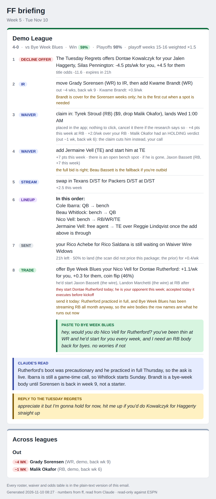
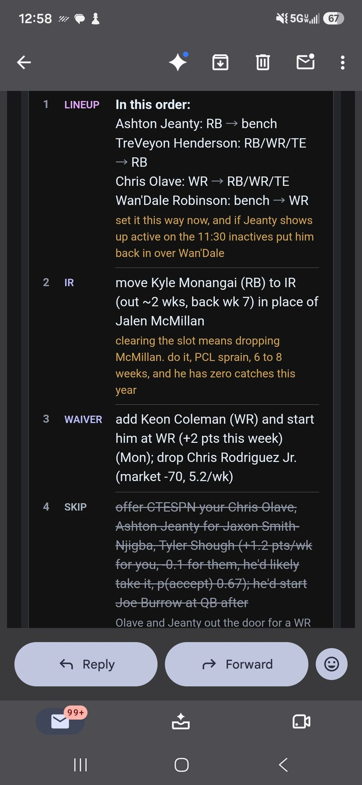
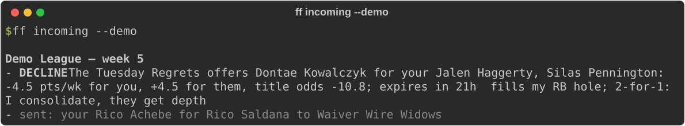
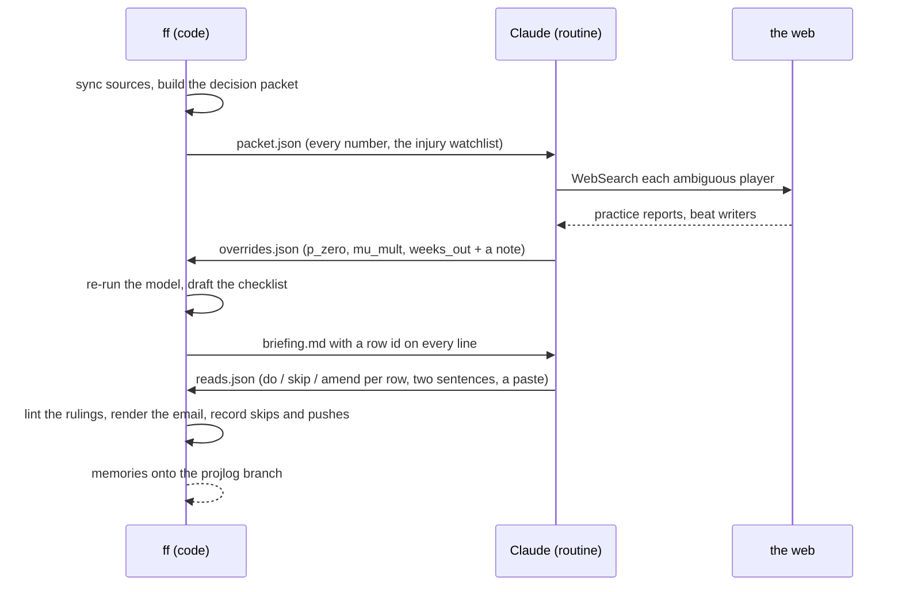
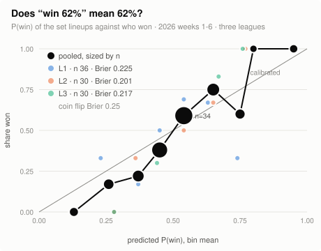
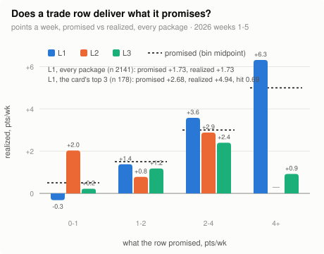
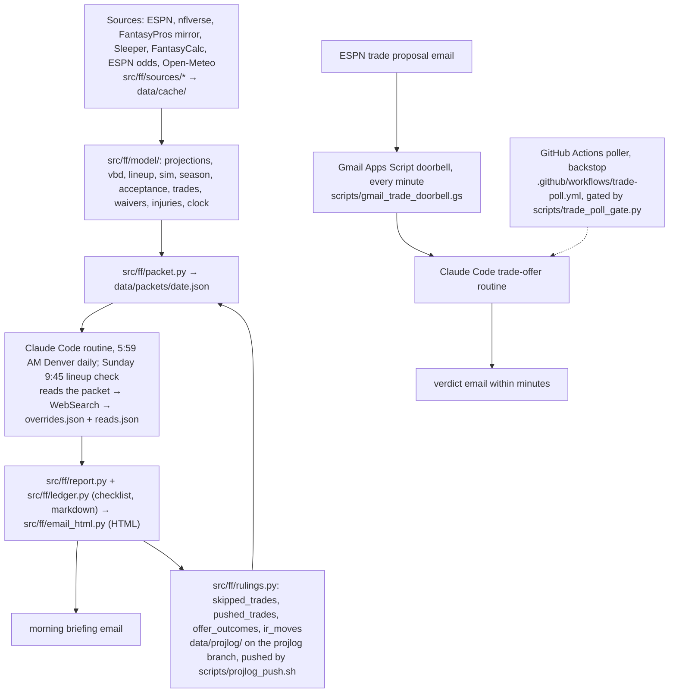
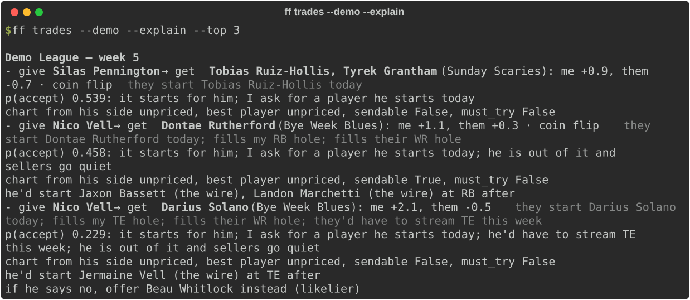

# ff — a fantasy football co-manager

[](https://github.com/dustinJ15/fantasy/actions/workflows/ci.yml)
[](LICENSE)


*Deterministic analytics for ESPN leagues. Claude reads the news. I tap the buttons.*

I joined three fantasy football leagues this year knowing roughly nothing, so naturally I built a quant desk.
Every morning a script pulls my ESPN leagues, runs the math, and an LLM reads the injury reports and writes me an email
that says what to do. Everything is read-only against ESPN; I make the moves myself. I may or may not be cheating.

If you are here from a résumé: this is an LLM-in-the-loop decision system with a measured probabilistic model under
it, running unattended since September 2026, with the model's claims graded against the season it is playing.

[At a glance](#at-a-glance) · [The one rule](#the-one-rule) · [What the math does](#what-the-math-does) · [Results](#results-measured-on-the-real-leagues) · [Architecture](#architecture) · [Try it](#try-it) · [Commands](#commands) · [How it was built](#how-it-was-built)

## At a glance

- **What it does.** Pulls three ESPN leagues, blends projections, models injury risk, optimizes lineups for P(win),
  simulates the season, scans every trade against every rival, prices waiver claims, and emails a numbered checklist
  in the order the app wants the clicks.
- **The one rule.** Code owns state and math; Claude owns judgment over unstructured text. Claude returns parameters
  and prose, never a number and never a decision. Every figure in the email comes from code.
- **Measured.** The win probabilities the card prints are calibrated: Brier 0.20-0.22 across three leagues over 96
  matchups, against 0.25 for a coin flip. Trade rows deliver what they promise: every package the scanner proposed in
  one league promised +1.73 points a week and realized +1.73.
- **Including the bad news.** The waiver-claim ranking graded worse than the managers' own adds. Two causes found, one
  a replay artifact, one a real pricing hole; both are written down below, and the constants stayed put.
- **How it runs.** Two scheduled Claude Code routines (the morning briefing and a Sunday lineup check), a one-minute
  Gmail Apps Script doorbell for incoming trade offers, a GitHub Actions poller as its backstop, and a backlog worked
  by fresh agent sessions one PR at a time.
- **How big.** About ten thousand lines of Python and about as many of tests. CI runs the whole pipeline on a
  synthetic league with no network and no credentials.

<table align="center">
  <tr>
    <td align="center" valign="top" width="640">
      <br>
      <sub>The morning email, from the demo league. Every name is made up; every number comes from <code>ff</code>.</sub>
    </td>
    <td align="center" valign="top" width="300">
      <br>
      <sub>The real one, on the phone, one Saturday in October. Row 2 is the bug fixed that afternoon: McMillan was locked in the IR slot.</sub>
    </td>
  </tr>
</table>

<p align="center">
  <br>
  <sub>The same offer from the terminal. Someone in a league of eight always wants your two starters for their one.</sub>
</p>

## The one rule

**Code owns state and math. Claude owns judgment over unstructured text.**

The deterministic side (`ff`, a Python CLI) pulls the data, blends projections, models injury risk, optimizes the
lineup, simulates the season, scans trades and prices waiver bids, then writes everything to a versioned JSON
"decision packet". The LLM side (a Claude Code routine) reads that packet, web-searches the players whose status is
ambiguous, and hands back two small JSON files:

```jsonc
// overrides.json: parameters, not decisions. Only for players where the news changed the picture.
{"100": {"p_zero": 0.5,  "note": "Q, DNP Friday; beat writer says game-time decision"},
 "108": {"mu_mult": 1.15, "note": "named the starter after the trade; expect a full workload"},
 "115": {"weeks_out": 6, "note": "high ankle sprain, team says 4-6 weeks; the card decides IR / hold / drop / trade"}}

// reads.json: one or two plain sentences per league, plus a message I can paste to a rival.
{"demo": {"read": "Decline. They're selling one good back for two of your starters and you're the favorite this week.",
          "reply": "appreciate it but I'm gonna hold for now", "reply_to": "The Tuesday Regrets"}}
```

`ff` re-runs with the overrides and renders the email. Every number in the briefing comes from code; Claude never
emits a figure, never edits the HTML, and never writes to ESPN. The full playbook the routine follows is
[.claude/skills/briefing/SKILL.md](.claude/skills/briefing/SKILL.md).

The morning, as a sequence. Code is on the left, the model on the right, and the two JSON files are the only things
that cross:



## What the math does

- **Projections**: equal-weight blend of ESPN and Sleeper stat projections, FantasyPros rank as a fallback, Vegas implied
  team total as a small multiplier. Wind at kickoff over 15 mph (Open-Meteo) discounts QB, WR, TE and K for this week
  only, flat past 25 mph; rest-of-season numbers never see it. Rest-of-season per game is season-to-date points per game
  with the preseason total as a prior that fades out by game six. Every source is logged daily to `data/projlog/` (the
  `projlog` branch) so `ff accuracy` can score each pre-kickoff forecast against ESPN's actual and say which one is good.
- **Fitted, not guessed**: the in-season terms are fitted on nflverse weekly stats 2016-2025, leave-one-season-out, in
  the live arithmetic's own shape (`src/ff/opfit.py`, `ff fit-opportunity`): how far a player's targets and carries
  pull his level (`OPPORTUNITY_WEIGHT`, 0.57-0.67 by position), how much the Vegas total moves a quarterback
  (`VEGAS_K` 0.41), and the opponent's schedule-adjusted points allowed (`OPPONENT_K`, capped at ±10% because the fit
  says the cap helps). Each fit's table and what it could not see is in `docs/plans/fitted-projection.md`.
- **Injury-aware distributions**: each player is a mixture of "plays" and "zero", with `p_zero` from the practice-report
  designation (day-aware for Questionable: 15% early in the week, 30% from Friday) and overridable by the morning
  research. A hurt player gets a hold / IR / drop / trade verdict from `weeks_out`, with the IR slot's history remembered
  so a bouncing tag does not churn the bench.
- **Win-probability lineups**: the optimizer maximizes P(beat this week's opponent), not expected points. Favorites get
  floor, underdogs get ceiling, without anyone deciding to. A deviation from the highest-points lineup has to buy at least
  1.5 pp of P(win) (`MIN_WIN_GAIN` in `src/ff/model/lineup.py`); the row prints the gain. From Saturday on the opponent is
  priced on his set lineup, not the optimizer's guess of his best one.
- **Monte Carlo season sim**: playoff and title odds for every team, and the common yardstick for every decision below.
  Playoff weeks are weighted by my playoff odds (`week_weight` in `src/ff/model/season.py`), so a dead team prices a
  week-16 return at nothing. Title-odds deltas on trade and offer rows re-sim with common random numbers, so a null
  trade reads 0.0 instead of seed noise.
- **Trade scanner**: every 1-for-1 and 2-for-1 against every rival, both rosters priced week by week with the wire as
  the fallback body, ranked by p(accept) × my gain (`src/ff/model/acceptance.py`: consolidation tax, star premium, a
  QB asked only from a roster with two, throw-ins refused). Incoming offers get an accept / decline / counter verdict
  the same way, plus a FantasyCalc market check. Skips, pushes and what rivals did with my offers are remembered
  (`src/ff/rulings.py`), so a package I passed on stays gone for two weeks and a rival who just declined costs the next
  package a factor. It also refuses to trade away your last healthy quarterback, which is more than I can say for myself.
- **Waivers**: value over your own starter. All three leagues run waiver priority, so a row says `claim` (still on
  waivers, with my priority and, in a rolling order, whether the claims that priority would win later are worth more
  than this one) or `add` (free agent, mine the moment I click); FAAB bids are still sized where a league uses them.
  Streamers for K and D/ST, handcuffs for my RB starters.
- **Checklist ledger**: every add spends a roster spot exactly once (`src/ff/ledger.py`: open bench spot first, then the
  cheapest drop not already named), so an activation and a pickup never cut the same body. The drop order is
  `drop_cost`: rest-of-season points plus a market penalty for cutting someone a rival would trade for, plus a
  handcuff's insurance value, less the week a body on bye gives the pickup nothing for. Bodies are counted against
  ESPN's per-position caps, so a trade row names the drop the trade screen will demand. The checklist runs in the order
  the app allows: IR moves and pickups first, then the lineup once the roster is what it will be, with a pickup who
  starts this week folded into the lineup row as a move conditional on the add.
- **Game clock**: once a player has kicked off he is locked and his actual points are banked, so the Monday email
  never suggests benching someone who already played. A locked player is also never today's drop or IR move, since
  ESPN refuses both until the week rolls on Tuesday; the row says so and names the day.

## Results, measured on the real leagues

Three leagues, anonymized L1, L2 and L3; 2026 weeks 1-6. `ff replay-pull` archives each week's box scores (both
lineups as set, ESPN's pre-kickoff projection and the actual per player) and `ff backtest` replays the season through
the same code the morning email runs, then grades every claim the card made against what happened next. Every table
below, the full bins, and the ruling under each one are in [docs/accuracy.md](docs/accuracy.md) (last re-run
2026-10-21); the charts are drawn from those numbers by `scripts/accuracy_charts.py`.

<table align="center">
  <tr>
    <td align="center" valign="top" width="460">
      <br>
      <sub>Reliability of the P(win) the card prints. Brier 0.20-0.22; a coin flip scores 0.25.</sub>
    </td>
    <td align="center" valign="top" width="460">
      <br>
      <sub>What a trade row promised against what the swap realized, every package the scanner proposed.</sub>
    </td>
  </tr>
</table>

| claim the card makes | n | promised | realized | ruling |
|---|---|---|---|---|
| "this lineup wins p" (P(win) of the set lineups) | 96 matchups | — | Brier 0.20-0.22 (coin flip 0.25) | `BASE_SIGMA` stays; the 0.7+ bins are 1-3 matchups each |
| the optimizer against the lineup the manager set | 192 team-weeks | — | managers left +1.8 and +2.8 pts/wk on the bench in L1 and L3, none in L2 | — |
| the P(win) lineup where it differs from max-points | 15 of 60 team-weeks (L2) | +4.7 pp | +6.7 pp (won 0.667 to 0.600) | `MIN_WIN_GAIN` stays; under the n of 20 that would move it |
| trade scan, every package (L1) | 2141 | +1.73 /wk | +1.73 /wk | `SEND_MIN_PPW` stays: the 0-1 bin is noise in every league |
| trade scan, the card's top 3 (L1) | 178 | +2.68 /wk | +4.94 /wk, hit 0.69 | `MUST_TRY_PPW` stays: the 2-4 bin realizes its promise in all three |

**The negative.** The waiver-claim ranking read worse than the league: the card's first claim each week realized 3.9
to 7.8 points a week *under* the starter it would have displaced, on a promise near zero, while the managers' own adds,
which the ranking priced at -3 a week, came out about even. Two causes, both visible in the tables once the rows were
split by whether a body went dark afterwards. ESPN zeroes the season total of any player on IR or Out on the day you
pull, so a replay pulled mid-season graded wire bodies on injuries it already knew about; the pull now carries that
flag (`total_zeroed` in `src/ff/backtest.py`) and the tables print with those rows apart. And fill-in quarterbacks
priced at ESPN's own weekly number went dark when the starter came back, which no price on the wire sees; that one is
a real hole and is logged as such. With both set aside, the claim-worthy rows where both players stayed on the field
promised +1.5 to +1.8 a week and realized +1.3 to +4.4. `CLAIM_WORTHY_PPW` stayed where it was.

**The blend.** Over weeks 1-4 no projection source trails the equal-weight blend by 5% at any position, so none is
re-weighted; quarterbacks ran about four points hot and tight ends four points cold across every source, which is a
calibration question for the variance fit, not a sourcing one. One finding shaped the whole exercise: ESPN serves a
completed season's scores but not its lineups, under every view the API has, so the backtest is the live season and
not a decade of history, re-pulled each time the tables are refreshed.

## Architecture



Operations, briefly: a scheduled Claude Code routine runs the playbook at 5:59 AM Denver every morning, and a second
one at 9:45 on Sundays, after inactives, re-checks my questionable starters and emails the final lineups. Each pings a
healthchecks.io dead-man's switch when it succeeds. When a rival sends an offer, a one-minute Apps Script in Gmail
spots ESPN's notification, dedupes by message id and fires a second routine that emails a verdict and a reply I can
paste; a GitHub Actions poller (`ff incoming --new-since 6h`, deduped by offer id, run only in season and outside
1-5 AM Denver by `scripts/trade_poll_gate.py`) is the backstop if the doorbell misses, and the morning briefing lists
every pending offer regardless. The crons, the alert paths and what to check when one goes quiet are in
[docs/operations.md](docs/operations.md). There is no code path that writes to ESPN, by construction.

## Try it

No ESPN account needed for the demo. It builds a synthetic 8-team league of fictional players (with a pending trade
offer) and runs the whole pipeline on it:

```
uv sync
uv run ff briefing --demo            # markdown briefing on stdout (--short for the card alone)
uv run ff incoming --demo            # the incoming-offer verdict
uv run ff trades --demo --explain    # every package the scanner likes, with the acceptance scorecard behind each
uv run ff odds --demo                # Monte Carlo playoff and title odds for the eight teams
uv run ff packet --demo              # the raw decision packet JSON
```

<p align="center">
  <br>
  <sub>The scorecard behind a trade row: p(accept) and the factors that moved it, what he would start after, and the fallback offer if he says no.</sub>
</p>

The output of exactly that, plus the rendered email, is in [examples/](examples/). `scripts/screenshots.sh` regenerates
all of it, images included; it needs a Chrome or Chromium binary (`CHROME=/path/to/chrome` if it is not on PATH). The
phone photo is the one file in there taken by hand.

For your own leagues:

```
cp .env.example .env                 # ESPN cookies, see scripts/setup_cookies.md
cp leagues.example.toml leagues.toml # league ids and your team id
uv run ff setup-check                # prints every team and marks yours
uv run ff sync && uv run ff briefing
```

## Commands

| command | what |
|---|---|
| `ff setup-check` | verify cookies and league ids, print teams |
| `ff doctor` | data freshness per source, cookie health |
| `ff sync [--force]` | refresh every source into `data/cache/` |
| `ff roster` | my roster with blended projections and flags |
| `ff lineup` | P(win)-optimal lineup vs this week's opponent, and how it differs from the max-points lineup |
| `ff waivers` | ranked free agents by value over my starter, streamers, handcuffs; the briefing's row says `claim` or `add` and prices the priority a claim spends (a FAAB bid where a league uses one) |
| `ff trades [--explain] [--top N]` | rival roster scan, candidate packages ranked by p(accept) × my gain; `--explain` prints the scorecard behind each row |
| `ff incoming [--json --new-since 40m]` | offers other managers sent me, with a verdict |
| `ff odds` | Monte Carlo playoff and title odds for every team |
| `ff packet` | write the versioned decision packet JSON (and close the memories: offer outcomes, IR moves) |
| `ff briefing [--overrides f] [--reads f] [--short]` | render the full markdown briefing |
| `ff render-email --packet p --reads f --out h --md m` | render the HTML email from an existing packet; records the trade rows Claude skipped or pushed |
| `ff log-projections` | append today's per-source projections to `data/projlog/` |
| `ff accuracy [--week N] [--fit]` | MAE and bias by source and position over scored weeks; `--fit` prints a fitted sigma per position next to the prior |
| `ff fit-opportunity` | fit the in-season projection constants on nflverse 2016-2025, leave-one-season-out, and print the table behind each |
| `ff replay-pull --season 2025` | archive a season's box scores (both lineups as set, ESPN's pre-kickoff projection and the actual per player) into `data/replay/` |
| `ff backtest [--replay f] [--trades] [--scan] [--claims]` | replay a season through the same code: P(win) calibration and the optimizer against the lineups managers set; `--trades` scores the offers ESPN executed, `--scan` and `--claims` grade every trade package and claim row the card would have printed |
| `ff email` / `ff heartbeat` | send a rendered briefing (an HTTPS POST to an Apps Script relay in my Gmail, or SMTP where port 465 is open); ping the healthchecks.io switch |

All commands that read a league take `--league <name>`; `briefing`, `packet`, `incoming` and the section commands
(`roster`, `lineup`, `waivers`, `trades`, `odds`) take `--demo`.

## How it was built

Python 3.12+, [uv](https://docs.astral.sh/uv/), typer, pydantic, numpy/scipy for the sims, polars for the nflverse
tables. The email is hand-rolled table HTML because email clients are where CSS goes to die. Five decisions carry the
rest.

**The LLM boundary is enforced, not requested.** Claude's two outputs are parameters (`p_zero`, `mu_mult`, `weeks_out`,
`ros_mult`) and prose. It rules on checklist rows by id (`do`, `skip`, `amend` with a note) rather than arguing with
the card, so a disagreement strikes the row instead of contradicting it two lines down. `read_lint` in
`src/ff/report.py` rejects a typo'd id or an unruled trade row before the email renders, `card_lint` catches the card
contradicting itself (one drop named on two rows, a hold on a body another row cuts), and `tests/test_skill_prompts.py`
holds the skill's prompt to the code's constants, so the instructions the model reads and the thresholds the code
applies cannot drift apart. The playbook is [.claude/skills/briefing/SKILL.md](.claude/skills/briefing/SKILL.md).

**Memory lives on a git branch.** The cloud VM clones fresh every run and there is no database. The four memories the
checklist depends on (trade rows I skipped, the one package I am pushing, what each rival did with my offers, who sat
in the IR slot) and the daily projection log ride the `projlog` branch: `scripts/projlog_push.sh` commits them onto the
branch's tip from a temporary index and never touches main, and `scripts/cloud_setup.sh` restores them on the next
clone. Free, diffable, and every ruling has a commit.

**The backlog runs as a loop of fresh sessions.** Each TODO item has its evidence and a done-when; a fresh Claude Code
session takes one item, opens one PR with the write-up in the body, and stops ([docs/ralph-loop.md](docs/ralph-loop.md)).
The first item through the loop shrank `CLAUDE.md`, because every session pays to read it before it reads the item;
`tests/test_docs.py` holds it under ninety lines and makes every markdown file register in `docs/README.md` with who it
is for. Each design in `docs/plans/` ends with "Questions, as decided", and `docs/failures.md` is the symptom, cause
and fix for everything that ever showed up wrong in an email.

**The tests run the whole pipeline with no network.** `src/ff/demo.py` is a synthetic eight-team league with seeded
fictional names and a pending offer; `uv run pytest` runs a few hundred tests over it and small fixtures with no
credentials (the count is whatever `uv run pytest --collect-only -q` says today). CI (`.github/workflows/ci.yml`) runs
ruff, the tests and the demo briefing on every push to main and every pull request. `tests/test_readme.py` checks that
every path and command this file names exists and that it never states a stale count; `tests/test_card.py` holds the
card's wording to what the state supports; `tests/test_accuracy_charts.py` checks the charts above against the doc they
were transcribed from. The backtest had to recover a synthetic season's known answers before it was pointed at a real
one (`docs/plans/backtest.md`). The Gmail doorbell and the send relay are Apps Script, so pytest cannot see them;
`node scripts/gmail_trade_doorbell.test.js` and `node scripts/gmail_send_relay.test.js` run them against a stubbed
runtime.

**Read-only, by construction.** `src/ff/sources/espn.py` issues no write; the routine's only outputs are two JSON files
and an email; the doorbell and the poller only read and only fire a routine. There is no lineup, waiver, trade or chat
call anywhere in the tree, so the worst a bad morning can do is send me a wrong email.

## Honest limits

The projections are borrowed, so the edge is in how they are used, not in the numbers. Variance is a prior, not
fitted: `ff accuracy --fit` fits a sigma per position but the priors stand until 150 scored forecasts, which is
late 2026 for RB and WR and years off for K and D/ST. Usage signals are thin until week 4. The backtest is six weeks
of one season, because ESPN keeps a completed season's scores and not its lineups, and the tails of the calibration
table are one to three matchups a bin until the regular season ends. [ROADMAP.md](ROADMAP.md) has the full list and
what would actually move the needle. [CLAUDE.md](CLAUDE.md) is the operator's manual the agent reads; it is more
useful than this file if you want to run it.

Data sources are all free and keyless: espn-api, nflreadpy, the dynastyprocess FantasyPros mirror, Sleeper,
FantasyCalc, the ESPN scoreboard, Open-Meteo. Nothing is scraped.

MIT licensed. Current record across three leagues: withheld, for the same reason the model calls variance "a prior".
